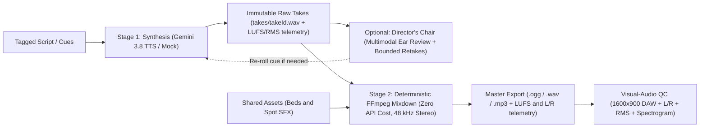
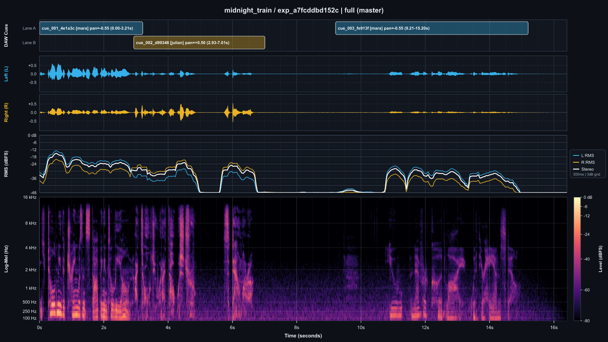

# The Booth

**A headless, open-source AI Audio Drama & Spoken-Word Studio.**

Most TTS scripts stitch raw API clips straight to digital silence—resulting in jarring headphone "dead air," mismatched clip loudness, hard-panned voices that feel unplugged, and wasted API spend every time you tweak a pause or fade.

**The Booth** is a TypeScript/Node studio engine that bakes real DAW acoustic craft into the pipeline itself. It exposes a local **Fastify REST API** and a 1:1 **Model Context Protocol (MCP) Server** over the exact same core, letting humans, applications, and multimodal AI agents cast voices, direct performances, layer soundscapes, inspect stereo mixes by **ears and eyes**, and render mastered stereo audio without burning tokens on re-mixes.

---

## Who Is This For?

- **AI Agents & Agent Platforms (MCP):** Give a multimodal agent its own recording studio. Connect The Booth over stdio MCP (`34` tools) so an agent can design or audition voices, block scenes, listen to takes by ear, inspect stereo mixes visually, and master finished audio end-to-end.
- **Audio Drama, Fiction & Spoken-Word Creators:** Write in readable, screenplay-style tagged scripts (`[[dir:...]]`, `[[overlap:350]]`, `[[pan:-0.6]]`, `[[eq:intimate]]`, `[[bed:...]]`, `[[sfx:...]]`) instead of wrestling with timelines or raw FFmpeg commands.
- **Late-Night, Sleep, Meditation & PMR Authors:** Built with headphone comfort as a first-class rule—continuous warm room tone so long pauses never drop into digital vacuum, gentle leveling that protects whispers, and optional master normalization off by default so quiet fade-outs stay quiet.
- **Developers & Voice-App Builders:** Integrate a clean, filesystem-backed REST API (`project.json` + immutable WAV takes) with a provider-agnostic `TtsProvider` interface, reference **Gemini 3.8 Flash TTS** adapter, and an offline `MockTtsProvider` for deterministic zero-cost testing.

> ### Model & MCP Host Compatibility (Please Read)
>
> - **Tested on Gemini 4 only:** The full multimodal agent workflow—listening directly to inline MCP `audio` blocks and inspecting `booth_inspect_visual` waveform/RMS/spectrogram charts—has **only been tested and empirically calibrated on Gemini 4** so far.
> - **Claude, ChatGPT & other models:** We cannot yet vouch for how well Claude, ChatGPT, or other models' native audio-listening or visual-audio spectrogram inspection chops hold up on this workflow.
> - **MCP host audio support varies:** Some MCP clients do not yet forward inline `audio` content blocks to the model. Even on text-only or vision-only hosts, you still get the full REST/MCP production engine, numeric loudness & L/R stereo telemetry, `booth_inspect_visual` PNG charts, and the built-in multimodal Director loop (`gemini-3.5-flash`).

---

## Why The Booth? (Two-Stage DAW Architecture)

The Booth splits audio production into two strict stages so **acting changes cost API calls, while mixing, pacing, EQ, panning, and soundscape tweaks are instant and free**:



### Acoustic Craft Built Into the Defaults

| Feature | How The Booth Handles It |
| :--- | :--- |
| **No Digital Vacuum** | Every new project initializes a subtle, seeded stereo `warm_dark` room-tone floor (`-54 dBFS`, shaped below ~2.4 kHz). Long pauses breathe like a real room instead of cutting to `-∞ dBFS` dead air. |
| **Immutable Raw Takes** | Stage 1 saves untouched provider WAVs at `takes/<takeId>.wav` and records read-only loudness telemetry (`measuredLufs`, `measuredRmsDbfs`, `peakDbfs`). Normalization is never baked destructively onto disk. |
| **Whisper-Safe `autoLevel`** | Stage 2 applies non-destructive clip gain toward `-20 LUFS`: `gentle` *(default, 50% pull clamped to `[-6, +4] dB`)* tames API spikes without blowing up soft breaths; `match` evens out audiobooks; `off` leaves raw dynamics untouched. |
| **Headphone-Friendly Panning** | Constant-power panning paired with phase-pure, head-shadowed headphone crossfeed (`~16%` near-to-far bleed, `0.25–0.45 ms` ITD, `4 kHz` LPF) so panned voices feel naturally placed in space rather than trapped in one earcup. |
| **Dialogue Overlaps & Micro-Fades** | Supports negative cue offsets (`[[overlap:350]]`) for natural interruptions, plus gentle cosine edge fades (`20 ms` in / `30 ms` out) so clips never click and soft inhales are never clipped. |
| **Speech-Triggered Bed Ducking** | Continuous ambient beds (rain, fireplace, music) smoothly duck underneath the unified speech bus (`attack: 100 ms`, `release: 800 ms`) and bloom back up during pauses. |
| **Take Preservation on Re-Import** | Each take hashes `(text + direction + providerVoiceId)`. Re-importing an edited script in `replace` mode automatically preserves and re-attaches unchanged takes—fixing a typo or pause never re-renders the whole script. |
| **Eyes + Ears QC** | Multimodal audio encoders downmix stereo to mono. `booth_inspect_visual` renders calibrated `1600×900` 4-panel charts (DAW cue overlay, split L/R waveforms, 300 ms RMS curves on a 3 dB grid, and Log-Mel spectrogram) so agents can verify stereo blocking and spot clicks, clipping, or dropouts visually. |

---

## Prerequisites

- **Node.js `>= 22`**
- **FFmpeg & FFprobe** installed and available on your `PATH` (or configured via `FFMPEG_PATH` / `FFPROBE_PATH` in `.env`)
- *(Optional)* A **Google AI Studio `GEMINI_API_KEY`** for live Gemini 3.8 Flash TTS, custom voice design, and the multimodal Director. Without a key, The Booth runs offline using `MockTtsProvider` and `MockDirectorReviewer`.

---

## Quick Start

```bash
# 1. Clone and install
git clone https://github.com/pirsqed/TheBooth.git
cd TheBooth
npm install

# 2. Configure environment (GEMINI_API_KEY is optional for offline testing)
cp .env.example .env

# 3. Run the full offline test suite (uses MockTtsProvider + local FFmpeg)
npm test

# 4. Start the local REST API server (http://127.0.0.1:3480)
npm run dev
```

To build for production or run the compiled MCP server:

```bash
npm run build
npm start       # Compiled REST API server (dist/index.js)
npm run mcp:start  # Compiled MCP stdio server (dist/mcp/index.js)
```

---

## How to Use The Booth

You can drive The Booth in three ways—and because the REST server and MCP server share the exact same `DATA_DIR` filesystem layout, projects created in one are immediately accessible in the other.

### 1. Connect an AI Agent via MCP

Build once (`npm run build`), then register The Booth in your MCP client config (Claude Desktop, Cursor, or custom agent runtimes):

```json
{
  "mcpServers": {
    "the-booth": {
      "command": "node",
      "args": ["/absolute/path/to/TheBooth/dist/mcp/index.js"],
      "cwd": "/absolute/path/to/TheBooth",
      "env": {
        "DATA_DIR": "/absolute/path/to/TheBooth/data"
      }
    }
  }
}
```

*(If `GEMINI_API_KEY` is in `.env` inside `cwd`, it loads automatically. Otherwise pass `"GEMINI_API_KEY"` in `env`.)*

Once connected, your agent gets **34 MCP tools** covering the full production pipeline—projects, script import, voice catalog/design/auditioning, Stage-1 synthesis, inline audio listening (`audio/wav` / `audio/ogg`), beds & SFX, Stage-2 mixdown, automated Director review, and visual-audio inspection (`image/png`).

#### Companion Agent Skill & Director Persona

- **Recommended — Agent Skill ([`skills/the-booth/SKILL.md`](./skills/the-booth/SKILL.md)):** Drop-in, persona-neutral **"soft director"** skill for MCP-connected agents. Copy or symlink `skills/the-booth/` into your agent's skills directory (e.g., `~/.gemini/config/skills/`, `~/.agents/skills/`, or `~/.claude/skills/`). It teaches your agent to cast and block scenes before spending synthesis tokens, keep Stage-1 acting separate from free Stage-2 mix edits, cap retakes at 2–3, and run calibrated **Eyes + Ears** final QC—without overriding the agent's own voice.
- **Optional — Full Auteur Mode ([`directors/margaux_auteur.md`](./directors/margaux_auteur.md)):** Want a fierce creative partner who pushes back on flat first drafts? Load **Margaux Laurent** into your agent's system prompt for a grizzled radio-drama auteur who fights for breath, overlaps, and honest takes.

#### Try This as Your First Prompt

Once the MCP server (and optional skill) is connected, try prompting your agent with:

> *"Create a Booth project called `midnight_train`, audition two contrasting voices for Mara and Julian, block a short 2-speaker noir exchange with stereo panning and a natural interruption overlap, mix it to OGG, and verify the final mix with both ears and `booth_inspect_visual`."*

See the full setup & tool catalog in **[docs/mcp.md](./docs/mcp.md)**.

---

### 2. Author Scenes with Tagged Scripts

Import plain text containing **sticky directives** (`[[...]]`) and screenplay-style speaker prefixes (`NAME: Line`) via `POST /projects/:id/import-script` or `booth_import_script`. Inline provider vocal cues like `<sigh>`, `<chuckle>`, and `<short pause>` are preserved verbatim.

```text
[[bed:rain_window.wav gain=-26dB duck=-6dB]]
[[eq:intimate]]

[[voice:mara]]
[[pan:-0.45]]
[[dir:low, dry, caught half a breath short, close to the mic]]
You told me the train wasn't stopping until Lyon.

[[overlap:280]]
[[voice:julian]]
[[pan:0.45]]
[[dir:guarded, quiet urgency, trying not to wake the next car]]
I told you what I thought was true. <short pause> Sit down, Mara.

[[pause:2.5]]
[[sfx:glass_set_down.wav anchor=next offset=-400ms gain=-12dB pan=-0.3]]
[[voice:mara]]
[[pan:-0.55]]
[[gain:-3dB]]
[[dir:barely above a whisper, jaw loose, unhurried]]
<sigh> You never could lie with your hands still.
```

**Core Directives Cheat Sheet:**

| Directive | Scope | Example |
| :--- | :--- | :--- |
| `[[voice:<id>]]` or `NAME: ...` | Sticky | `[[voice:mara]]` or `MARA: Hello.` |
| `[[dir:<style>]]` | Sticky | `[[dir:warm, unhurried, close whisper]]` / `[[dir:reset]]` |
| `[[pause:<dur>]]` | Next cue | `[[pause:3]]` (seconds) or `[[pause:750ms]]` |
| `[[overlap:<ms>]]` | Next cue | `[[overlap:350]]` (starts `350 ms` before previous cue ends) |
| `[[gain:<dB>]]` | Sticky | `[[gain:-4dB]]` / `[[gain:reset]]` (`-24` to `+12 dB`) |
| `[[pan:<val>]]` | Sticky | `[[pan:-0.6]]`, `left`, `right`, `center`, `hard-left`, `hard-right` |
| `[[eq:<preset>]]` | Sticky | `neutral`, `intimate`, `whisper`, `phone`, `radio`, `distant` |
| `[[autolevel:<mode>]]` | Sticky | `gentle`, `match`, `off`, `reset` |
| `[[bed:<asset\|room_tone> ...]]` | Project | `[[bed:rain.wav gain=-24dB duck=-6dB]]` |
| `[[sfx:<asset> ...]]` | Anchored | `[[sfx:door.wav anchor=next offset=-500ms pan=0.4]]` |

Read the complete authoring guide (including EQ/pan tables and full genre examples) in **[docs/script-markup.md](./docs/script-markup.md)**.

---

### 3. Drive the Local REST API

Start the server (`npm run dev`), then create a project, cast a voice, import a script, render takes, and run a zero-cost stereo mixdown. *(No `GEMINI_API_KEY` yet? Swap `"provider": "mock"` and `"providerVoiceId": "mock_mara"` in step 2 to run the full loop—including OGG export and `/visual` PNG charts—completely offline.)*

```bash
# 1. Create a project (initializes default warm_dark room tone)
curl -s -X POST http://127.0.0.1:3480/projects \
  -H "Content-Type: application/json" \
  -d '{"id":"midnight_train","name":"Midnight Train"}'

# 2. Register a speaker voice (use provider:"mock" to test without an API key)
curl -s -X PUT http://127.0.0.1:3480/projects/midnight_train/voices/narrator \
  -H "Content-Type: application/json" \
  -d '{
    "label": "Narrator",
    "provider": "gemini",
    "providerVoiceId": "Kore",
    "defaultDirection": "warm, unhurried, intimate",
    "defaultEqPreset": "intimate"
  }'

# 3. Import a tagged script
curl -s -X POST http://127.0.0.1:3480/projects/midnight_train/import-script \
  -H "Content-Type: application/json" \
  -d '{
    "mode": "replace",
    "script": "[[voice:narrator]]\nThe platform clock stopped at eleven.\n\n[[pause:2]]\n[[pan:-0.5]]\n[[dir:softer, closer whisper]]\nNobody noticed until the fog rolled in."
  }'

# 4. Stage 1 — Synthesize all missing/stale cues (wait=true blocks until done)
curl -s -X POST http://127.0.0.1:3480/projects/midnight_train/render-all \
  -H "Content-Type: application/json" \
  -d '{"wait":true,"concurrency":2}'

# 5. Stage 2 — Local deterministic stereo mixdown (ogg, wav, or mp3)
curl -s -X POST http://127.0.0.1:3480/projects/midnight_train/mix \
  -H "Content-Type: application/json" \
  -d '{"format":"ogg"}'
```

Download the rendered master at `GET /projects/midnight_train/exports/<exportId>/audio`, or inspect its calibrated 4-panel visual QC chart at `GET /projects/midnight_train/exports/<exportId>/visual`.

See every endpoint, query parameter, and response format in **[docs/rest-api.md](./docs/rest-api.md)**.

---

## Casting, Director's Chair & Visual-Audio QC

Beyond basic synthesis and mixing, The Booth includes three studio-grade production workflows:

1. **Voice Discovery, Design & Auditions:** Filter prebuilt and Extended Voice Library voices (`booth_list_provider_voices`), generate persistent custom or remixed voices via Gemini's `v1beta` Voices API (`booth_design_voice`), and run side-by-side auditions (`booth_audition_voice` → `booth_select_audition`).
2. **Multimodal Director's Chair:** Run an automated ear-review loop on a single cue (`booth_direct_cue`) or an entire project (`booth_direct_project`) with strict retake budgets (`maxRetakes`, `maxTotalRetakes`). Choose from four built-in personas (`default`, `intimate_sleep`, `audio_drama`, `audiobook`) or supply your own persona instructions.
3. **Visual-Audio Inspection ("Eyes + Ears"):** Render `1600×900` PNG charts (`booth_inspect_visual` / `GET .../visual`) in `master` mode (4-panel DAW Cue Overlay + Split L/R Waveforms + Split L/R & Combined 300 ms RMS on a 3 dB grid + Log-Mel Spectrogram) or zero-JS `fast` mode (pure FFmpeg). Designed from a 3-phase blinded psychophysics study on Gemini 4 ([study spec & results](./docs/visual-audio-psychophysics-study.md)): on matched studio mixes, ears-only caught `0/2` technical defects (mono downmix + smoothed dropout) and eyes-only caught `2/3` (`0.00s` timing error), while **Eyes + Ears together hit `4/4` (100%)**—ears catching delivery mismatches while eyes caught wrong pan, `-4 dB` dips, and micro-clicks.



*Real `booth_inspect_visual` (`preset: "master"`) render of a 3-cue stereo exchange (`mara` left `-0.55`, `julian` right `+0.50`): note the `280 ms` overlap at `2.93s` with smooth L/R RMS crossover and subtle headphone crossfeed, continuous `warm_dark` room tone across the `7.0–9.2s` pause (no dead-air dropout), an audible `<sigh>` breath column at `9.5s`, and the `-4 dB` whisper taper on `cue_003`.*

Read the full walkthrough in **[docs/directing-and-qc.md](./docs/directing-and-qc.md)**.

---

## Configuration

Copy `.env.example` to `.env`. All settings are validated at startup via Zod (`src/config.ts`):

| Variable | Default | Description |
| :--- | :--- | :--- |
| `GEMINI_API_KEY` | *(unset → `mock`)* | Google AI Studio API key for live Gemini TTS, Voices API, and Director review |
| `DATA_DIR` | `./data` | Root directory for projects, takes, exports, voice previews, and shared assets |
| `PORT` | `3480` | Local HTTP port for the Fastify REST server (binds `127.0.0.1`) |
| `FFMPEG_PATH` | `ffmpeg` | Path to `ffmpeg` executable |
| `FFPROBE_PATH` | `ffprobe` | Path to `ffprobe` executable |
| `GEMINI_TTS_MODEL` | `gemini-3.8-flash-tts` | Default Gemini TTS model (`gemini-3.8-flash-tts`, `gemini-3.8-flash-lite-tts`, etc.) |
| `GEMINI_DIRECTOR_MODEL` | `gemini-3.5-flash` | Default multimodal model for Director take review |
| `GEMINI_SAFETY_THRESHOLD` | `off` | Gemini safety setting (`off`, `block_none`, `block_only_high`, `block_medium_and_above`, `block_low_and_above`) |
| `ALLOW_CUSTOM_FFMPEG_FILTER` | `false` | Opt-in flag allowing per-cue `mix.customFfmpegFilter` strings |

---

## Project Storage & Repo Layout

Projects live in portable, human-inspectable directories under `DATA_DIR` (gitignored by default):

```text
data/
  assets/                        # Shared reusable beds & SFX (sandboxed, no path traversal)
  voice_previews/                # Cached sample_audio WAVs for custom designed voices
  projects/
    <projectId>/
      project.json               # Canonical manifest (atomic temp-file + rename writes)
      takes/
        <takeId>.wav             # Immutable raw provider WAVs (flat layout for textHash reuse)
      auditions/
        <auditionId>.wav         # Candidate voice audition clips
      exports/
        <exportId>.ogg           # Mastered stereo exports (.ogg / .wav / .mp3)
        <exportId>.json          # Export telemetry (LUFS, true peak, L/R RMS, warnings)
      visuals/
        <id>_<preset>_<hash>.png # Cached 1600x900 visual-audio QC charts
```

Core modules and agent assets live under:

- `src/studio/` — Core `StudioService`, atomic `ProjectStore` (per-project mutex), async `JobTracker`
- `src/audio/` — FFmpeg runner, `autoLevel`, `roomtone`, `eq`, constant-power `pan` + crossfeed, `timeline` resolver, `mixdown` filtergraph compiler, `visualize` PNG engine
- `src/script/` — Tagged script parser (`parser.ts`)
- `src/providers/` — `TtsProvider` contract, `GeminiTtsProvider`, deterministic `MockTtsProvider`
- `src/director/` — `DirectorReviewer` contract, `GeminiDirectorReviewer`, `MockDirectorReviewer`, built-in `personas`
- `src/api/` — Thin Fastify REST server & routes
- `src/mcp/` — Thin `@modelcontextprotocol/sdk` stdio server (`34` tools + `booth://runtime/idle`)
- `skills/the-booth/SKILL.md` — Companion persona-neutral Agent Skill ("soft director" + Eyes + Ears QC protocol)
- `directors/margaux_auteur.md` — Optional drop-in high-friction radio-drama Director persona

---

## NPM Scripts

| Script | Purpose |
| :--- | :--- |
| `npm run dev` | Start the Fastify REST server in watch mode (`http://127.0.0.1:3480`) |
| `npm run build` | Compile TypeScript to `dist/` |
| `npm start` | Run the compiled REST server (`dist/index.js`) |
| `npm run mcp` | Run the MCP stdio server directly via `tsx` (no build step) |
| `npm run mcp:start` | Run the compiled MCP stdio server (`dist/mcp/index.js`) |
| `npm run typecheck` | Strict TypeScript check across `src/` and `tests/` |
| `npm test` | Run the full Vitest suite offline (zero API key required) |
| `npm run test:watch` | Run Vitest in watch mode |

---

## Documentation

- **[Script Markup & Authoring Guide](./docs/script-markup.md)** — Complete syntax for `[[...]]` directives, EQ/pan presets, beds, SFX anchoring, and worked examples
- **[REST API Reference](./docs/rest-api.md)** — All HTTP endpoints, payloads, streaming audio routes, and visual QC parameters
- **[MCP Server & Tool Reference](./docs/mcp.md)** — Stdio setup, client snippet, inline audio limits, and all 34 MCP tools
- **[The Booth Agent Skill](./skills/the-booth/SKILL.md)** — Drop-in persona-neutral "soft director" skill & calibrated Eyes + Ears QC protocol
- **[Casting, Director's Chair & Visual QC Guide](./docs/directing-and-qc.md)** — Voice design, auditions, automated Director personas, and Eyes + Ears inspection
- **[Margaux Laurent Director Persona](./directors/margaux_auteur.md)** — Drop-in system prompt for a fierce, taste-driven radio-drama director
- **[Technical Specification](./SPEC.md)** — Original v0.1 architectural design & acoustic rules
- **[Gemini 3.8 TTS & Voices API Reference](./docs/gemini-tts.md)** — Prompting craft, inline vocal tags, and Voices API details
- **[Gemini Interactions API Reference](./docs/gemini-interactions-api.md)** — Interactions API schema & behavior notes
- **[Visual-Audio Psychophysics Study Spec](./docs/visual-audio-psychophysics-study.md)** — Experimental study behind `booth_inspect_visual`

---

## License

MIT — see [LICENSE](./LICENSE).
