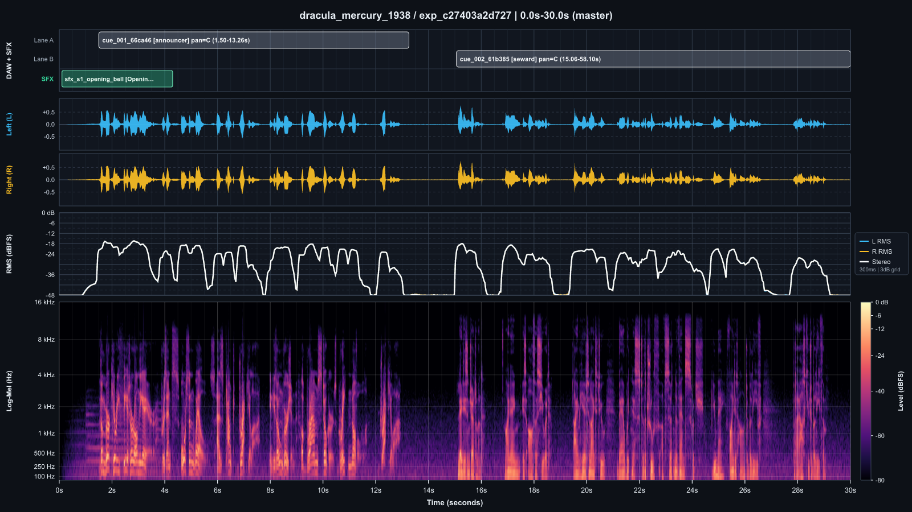
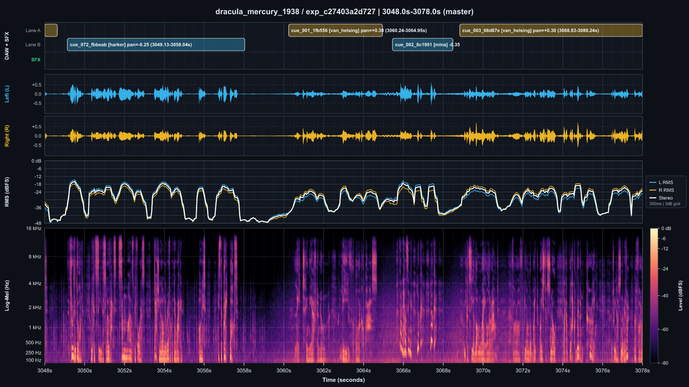

# Case Study & Post-Mortem: Producing a Full-Hour *Dracula (1938)* Radio Drama in The Booth (v0.1)

**Date:** November 2026  
**Source Material:** Orson Welles's July 11, 1938 *CBS Mercury Theatre on the Air — Dracula* (833-line broadcast script)  
**Production Setup:** Autonomous multimodal AI director (Gemini 4 driving The Booth over MCP with [`skills/the-booth/SKILL.md`](../skills/the-booth/SKILL.md) and local-file audio/image inspection)  
**Asset Libraries Mounted:** `@nps` (`200` Public Domain National Park Service field recordings) + `@usc` (`790` CC0 1.0 USC Cinema / Sunset Editorial archival mono foley tracks) + `4` local foley clips

> **Why publish this?** Most AI audio demos show a cherry-picked 30-second clip. To actually stress-test The Booth v0.1, we ran an end-to-end **59.5-minute full-cast radio drama** from cold start to stereo master—and then reviewed both the telemetry and the finished audio with human ears. This report documents the full process, what held up at broadcast length, and an honest accounting of the flaws that slipped through. Every rough edge surfaced here directly feeds the **[v0.2 Roadmap](./roadmap-v02.md)**.

---

## 1. Production Telemetry at a Glance

| Metric | Result |
| :--- | :--- |
| **Total Wall-Clock Production Time** | **1 hr 05 min** (cold start through casting, 7 scene mixes, full master, and seam QC) |
| **Final Master Runtime** | **59m 30.1s** (`3,570,137 ms`, incl. `1.5s` `leadInMs` cold-open bell + `2.5s` tail) |
| **Master Format & Size** | Stereo 48 kHz OGG/Opus (`128 kbps` VBR, `56.0 MB`) |
| **Integrated Loudness / True Peak** | **`-20.3 LUFS`** / **`-1.0 dBTP`** (`masterNormalize: false`) |
| **Stereo L / R RMS Symmetry** | **`-24.53 dBFS` (L) / `-24.32 dBFS` (R)** (`0.21 dB` delta across the full hour) |
| **Production Scope** | **12** bespoke voices · **288** cues (`100%` rendered, `0` retakes) · **28** beds (`27` cue-anchored + room tone) · **65** spot SFX · **7** scenes · **0** engine warnings |
| **Exports Generated** | **8** total (`7` scene-scoped partial OGG mixes for iterative QC + `1` full-hour master) |

---

## 2. How the Production Was Run

### The Bare-Minimum Sound Library Setup (and Why It Matters)

Before starting, we wanted to prove The Booth's external asset pipeline (`ASSET_LIBRARY_DIRS` + `booth_index_assets` + `booth_search_assets`) could drive a full-hour period drama using **zero-dollar public-domain / CC0 libraries**:

- **`@nps` (`200` files):** Public Domain National Park Service natural soundscapes (storms, wind, rivers, ocean surf, wolves, Yellowstone's eerie *Singing Lake* ice acoustics).
- **`@usc` (`790` files, `~2.23 GB`, 48 kHz mono `.flac`):** CC0 1.0 USC Cinema / Sunset Editorial *"Red & Gold"* archival Hollywood studio foley digitized on the Internet Archive (doors, creaks, footsteps, carriages, thunder, bells, glass, fire, riverboats).
- **Local project foley (`4` files):** Match/candle and shaving-mirror prop clips carried over from an earlier single-scene test.

Across the finished hour, the director drew from **11 unique bed assets** (`14` `@nps` placements, `13` `@usc` placements, plus synthetic room tone) and **27 unique spot-SFX assets** (`47` `@usc`, `14` `@nps`, `4` local).

**Honest takeaway on libraries:** `@nps` + `@usc` were truly the **bare minimum**. While they proved that non-destructive slicing and `rmsDbfs` indexing can squeeze broadcast-usable atmosphere out of free archival transfers, archival mono packs have clear ceilings: thin variety per category, mono-only transfers, `20+ dB` source level swings, and frequent **spoken 1970s engineer tape slates** embedded at the head or tail of files (requiring manual slicing on `56` of `65` SFX and `27` of `28` beds). Future productions backed by curated modern stereo SFX libraries (e.g., Sonniss, Pro Sound Effects, Boom) should see an immediate, substantial jump in realism and pacing polish.

### The 4-Phase Long-Form Workflow

Rather than pasting an 833-line script into one giant import, the director followed a four-phase cadence anchored by a plain-Markdown **Director's Bible** kept on disk:

1. **Phase 0 — Read Whole & Write the Director's Bible (Zero Synthesis):** Read the entire script start-to-finish, divide it into 7 acoustic scenes, lock proper-noun pronunciations (*Carfax*, *Bistritz*, *Demeter*, *Westenra*, *Calèche*, *Szgany*, etc.), fix obvious OCR typos while keeping Welles's dialogue text-locked, and pre-audition recurring soundscapes so Castle Dracula and Borgo Pass sound identical in Scenes 1, 2, and 7.
2. **Phase 1 — Cast the Entire Ensemble Upfront:** Design all 12 bespoke voices (`booth_design_voice`) to occupy distinct pitch, accent, and texture lanes, vetting them on real script lines via loudness-matched A/B audition reels before rendering any scene.
3. **Phase 2 — Scene-by-Scene Production & QC:** Block, synthesize (`booth_render_all`), attach cue-anchored beds and sliced SFX, run a fast scene-scoped partial mix (`booth_mix` with `fromCueId`/`toCueId`), and run Eyes + Ears QC on each 4–14 minute scene before moving on.
4. **Phase 3 — Full-Hour Assembly & Seam Pass:** Render the full 59.5-minute master with a `1500 ms` `leadInMs` cold open (cathedral bell before the CBS announcer) and inspect the opening, transitions, and outro by eyes and ears.

#### 7-Scene Acoustic Map

| Scene | Title | Runtime | Locations | Recurring Soundscape Anchors |
| :---: | :--- | :---: | :--- | :--- |
| **1** | Prelude & The Borgo Pass | 4m 26s | CBS Studio → Borgo Pass Coach → Dracula's Calèche | Warm studio room tone → Rattling carriage + La Chamisal Carpathian wind + Wolves |
| **2** | Castle Dracula: The Mirror & The Prisoner | 7m 11s | Courtyard → Harker's Chamber → Great Door | Slow howling castle wind + Carpathian wind + Wolves + Mirror/candle foley |
| **3** | The Wreck of the *Demeter* | 7m 25s | Whitby Cliff → Schooner *Demeter* at Sea | Whitby thunder/rain + Carpathian gale + Rushing sea + Creaking ship timbers |
| **4** | Lucy Westenra & The Churchyard Tomb | 14m 09s | Telegraph → Lucy's Room → London Street → Tomb | Purfleet night rain → Street bustle → Churchyard wind + Clock bell + *Singing Lake* ice drone |
| **5** | The Solemn Pact & The Raid on Piccadilly | 8m 19s | Seward's Study → Mina's Room → Train → Piccadilly | Study hearth fire + Supernatural mist drone → Steam train → Hollow castle wind |
| **6** | Hypnosis & The Hunt Across Europe | 9m 27s | Study → Varna → Galatz Harbor → Sereth River | Trance drone + Lapping water → Train roar/whistle → Riverboat & carriage cross-cuts |
| **7** | Climax at the Borgo Pass & Epilogue | 8m 29s | Borgo Pass Snowfields → Epilogue → CBS Sign-Off | **Exact Scenes 1–2 Carpathian + Castle wind beds** + Trance drone → Studio outro & final wolf |

#### 12-Voice Ensemble Contrast Roster

| Role | Accent / Era | Default Pan | Vocal Contrast Lane |
| :--- | :--- | :---: | :--- |
| **Count Dracula** (+ Driver) | Mid-Atlantic / Carpathian theatrical | `0.00` | Deepest, slowest mahogany bass-baritone |
| **Jonathan Harker** | Crisp 1890s Victorian RP | `-0.25` | Youngest, brightest male lead (tenor-baritone) |
| **Dr. Arthur Seward** | Refined Victorian English RP | `+0.15` | Warm, haunted mid-baritone narrator anchor |
| **Prof. Van Helsing** | Dutch academic English | `+0.40` | Weathered, gravelly Old World baritone |
| **Mina Harker** | Cultured Victorian English RP | `-0.30` | Rich warm alto / low mezzo, hypnotic in trance |
| **Lucy Westenra** | Upper-class Victorian RP | `+0.35` | Silvery, airy light soprano; feral in undeath |
| **Captain of the *Demeter*** | Weathered Russian maritime English | `-0.10` | Salt-roughened low Slavic baritone |
| **First Mate of the *Demeter*** | Rough Eastern European English | `+0.45` | Tight, raspy anxious tenor |
| **CBS Announcer / Press** | 1938 Transatlantic American Radio | `0.00` (`radio`) | Golden-age CBS broadcast baritone |
| **Orson Welles (Outro)** | 1938 American theatrical baritone | `0.00` (`intimate`) | Warm, mischievous echo of Dracula |
| **Carpathian Folk Ensemble** | Gnarled Carpathian-Germanic folk | `±0.50` | Gruff Old World character baritone |
| **London Street & Sailors** | Brassy Cockney London English | `±0.55` | Punchy working-class street tenor |

### Eyes + Ears Visual QC in Action

To keep long-form context lean, the director passed `inlineAudio: false` and `inlineImage: false` on Booth tool calls and inspected the returned local `.ogg` and `1600×900` PNG charts directly.

*Master cold open (`0.0s–30.0s`): `leadInMs: 1500` lets the emerald `sfx_s1_opening_bell` strike cleanly before cue 1 enters at `1.50s`. Note the band-limited `radio` EQ spectral ceiling on the CBS Announcer (`1.5s–13.3s`) compared to Dr. Seward's full-bandwidth narration starting at `15.1s`.*

*Scene 6 → Scene 7 seam at 51 minutes (`3048s–3078s`): continuous Carpathian wind bridges the transition (`3058s–3060s`) with no digital vacuum, while split L/R waveforms and RMS tracks verify stereo stage blocking (Harker left `-0.25`, Van Helsing right `+0.30`, Mina left `-0.35`) with headphone crossfeed intact.*

---

## 3. What Held Up Under Full-Hour Stress

Every core v0.1 primitive survived 288 cues and 59.5 minutes with zero crashes, zero audio corruption, and zero engine warnings:

1. **Cue-Anchored Ambient Beds (`startCueId` / `endCueId`):** The MVP of long-form production. Locking 27 location beds directly to cue edges prevented millisecond cascade breakage and maintained acoustic continuity across 250+ cues (including Yellowstone's `Singing_Lake.mp3` recurring as a supernatural leitmotif across Scenes 4–7).
2. **Scene-Scoped Partial Mixes (`fromCueId` / `toCueId`):** Made it practical to mix and QC 4–14 minute scenes iteratively without re-rendering the entire hour.
3. **Input-Side `.flac` Slicing (`clipStartMs` / `clipDurationMs`) + `rmsDbfs` Metadata:** Frame-accurate slicing cleanly dodged spoken engineer slates on archival USC clips (`"Thirteen"`, `"Five"`, `"And run by"`, `"Okay"`), while native `rmsDbfs` eliminated `20+ dB` archival gain guesswork.
4. **Cold-Open `leadInMs` & Emerald `SFX` Overlay Lane:** Delivered an authentic 1938 CBS cathedral-bell opening and made SFX-to-dialogue alignment inspectable on `<= 45s` zoom charts.
5. **Eyes + Ears QC Catching Real Archive Traps:**
   - Rejected an acoustic twin (`@usc/Boats/R05-35-Boat Sounds.flac` — actually a modern diesel foghorn, not a sailing schooner) before mixing the *Demeter*.
   - Caught a spoken `"Action!"` engineer slate hidden inside Scene 4's telegraph clip during ear QC and swapped it cleanly in Stage 2 without re-synthesizing a single line of speech.
6. **Plain-Markdown Director's Bible:** Survived 288 cues and context compaction without drift—proving The Booth does not need a heavyweight built-in note CMS.

---

## 4. Honest Post-Mortem: What Went Wrong

Telemetry alone looks glossy (`-20.3 LUFS`, `0` retakes, `0` warnings). **Actually listening to the finished hour with human ears—and cross-checking against per-cue telemetry—uncovered four major areas where v0.1 and the workflow fell short.**

### 4.1 Character Volume Imbalances (The `9.8 dB` Voice Spread)

Human listening immediately flagged that **many scenes with Lucy Westenra were noticeably too quiet**, alongside noticeable loudness jumps between speakers. Pulling per-speaker raw loudness telemetry from `project.json` exposed the exact mechanical cause:

| Speaker | Cues | Avg Raw LUFS | Raw LUFS Range | Cue `gainDb` Trims Used |
| :--- | :---: | :---: | :---: | :---: |
| `uk_street` (London Street & Sailors) | 5 | **`-14.6`** | `-15.7 .. -13.8` | `0.0 dB` |
| `announcer` (CBS Announcer) | 7 | **`-16.0`** | `-17.8 .. -14.4` | `0.0 dB` |
| `dracula` (Count Dracula) | 28 | `-18.2` | `-21.2 .. -12.7` | `0.0 dB` |
| `mina` (Mina Harker) | 36 | `-18.4` | `-25.9 .. -14.1` | `0.0 dB` |
| `captain` (*Demeter* Captain) | 11 | `-19.1` | `-21.7 .. -10.2` | `0.0 dB` |
| `harker` (Jonathan Harker) | 51 | `-20.0` | `-31.3 .. -12.9` | `-3.0 .. 0.0 dB` |
| `mate` (*Demeter* First Mate) | 8 | `-20.2` | `-23.0 .. -15.6` | `0.0 dB` |
| `van_helsing` (Prof. Van Helsing) | 65 | `-21.4` | `-30.0 .. -12.5` | `0.0 dB` |
| `seward` (Dr. Seward) | 52 | `-22.3` | `-31.7 .. -13.1` | `0.0 dB` |
| `orson` (Orson Welles) | 3 | `-22.3` | `-24.8 .. -19.9` | `0.0 dB` |
| `east_folk` (Carpathian Folk) | 11 | **`-24.1`** | `-26.8 .. -19.1` | `0.0 dB` |
| `lucy` (Lucy Westenra) | 11 | **`-24.4`** | `-33.9 .. -14.5` | `0.0 dB` |

Three factors compounded each other:
- **Intrinsic voice spread (`9.8 dB`):** Bespoke designed voices naturally synthesize at very different nominal levels (`-14.6 LUFS` for `uk_street` vs. `-24.4 LUFS` for `lucy`), and v0.1's `VoiceProfile` has **no `defaultGainDb` calibration field**.
- **Sandwiched quiet cues with zero trims:** Every single Lucy cue sat at `gainDb: 0`. Her softest takes—*"Arthur... I'm afraid"* (`-33.9 LUFS`, **`-16.1 dBFS` peak**) and her trance sigh (`-29.0 LUFS`, **`-14.8 dBFS` peak**)—were sandwiched directly between Seward (`-1.7` to `-5.1 dBFS` peak) and Dracula (`-2.7 dBFS` peak).
- **Clamped `gentle` leveling + no speaker-level warnings:** Because `autoLevel: "gentle"` only applies 50% pull toward `-20 LUFS` (clamped at `[-6, +4] dB`), a `-33.9 LUFS` line only lifted to `-29.9 LUFS` while `-14.6 LUFS` voices stayed hot—and `booth_mix` reported only overall mix LUFS (`-20.3`), hiding the per-speaker disparity.

### 4.2 "Momentum Bias" & Bad Takes That Slipped Through (`0` Retakes)

At first glance, `288 cues / 0 retakes` sounds like a win. In reality, it was a **50/50 split between genuine upfront prevention and long-form "momentum bias"**:

- Listening to 7–14 minute scenes in a single pass reliably caught **hard technical defects** (like a spoken `"Action!"` tape slate), but created a strong pull toward velocity—waving past weak or tonally off takes that a picky director should have re-rolled.
- **Concrete human-ear catches that momentum slid right past:**
  - **Cemetery scene (Seward & Van Helsing):** One of Seward's lines landed completely out of place tonally and broke the mood of the scene—an obvious retake candidate that wasn't caught.
  - **Aboard the *Demeter*:** One crewman's delivery came across as frantic hyperventilating, playing as unintentionally comical instead of tense.
  - **Pronunciation drift:** Dr. Seward's *"This is Dr. Seward"* leaned clipped (*"Dr. Sword"*) at the Scene 2→3 seam compared to *"Seward, Purfleet"* in Scene 4.

### 4.3 Poorly Timed Spot SFX

Several spot sound effects landed noticeably early, late, or awkward against the spoken action. Looking at `project.json` shows why: in v0.1, every SFX event can only anchor to a cue's `start` (`36` events) or `end` (`29` events) with a fixed millisecond offset (`49` negative pre-laps, `16` positive delays). When a cue is an 8–15 second monologue or reaction beat, landing a door knock, glass shatter, or footstep on a specific *mid-line* word without splitting the cue—or iteratively zooming and nudging—becomes guesswork.

### 4.4 Full-Hour Scale Bottlenecks & Tooling Friction

- **6-Minute Full-Hour Mixdown Tripped the 3-Minute MCP Timeout:** Mixing the full 59.5-minute master (288 cues + 28 beds + 65 SFX) took ~6 minutes in FFmpeg. While FFmpeg finished cleanly in the background, the synchronous MCP call timed out and required a manual wait.
  - *Root cause found in `src/audio/mixdown.ts`:* Each 32-cue batch padded its 48 kHz float32 intermediate WAV to the **entire 59.5-minute timeline** (`~1.37 GB` × 9 sequential batches ≈ **`12.3 GB`** of mostly-silent scratch I/O), and the final pass then `adelay`-ed and `apad`-ed all 65 spot SFX and 28 beds to the full hour—running 27 full-hour `sidechaincompress` filters and summing ~100 full-hour stereo streams in one `amix` graph.
- **Payload Bloat at 200+ Cues:** `booth_get_project` payloads grew large enough that the director wrote throwaway lookup scripts just to find cue IDs for bed anchors and partial mixes.
- **Dry Uniform Room Acoustics:** Every scene—from a cramped wooden ship cabin to a cavernous stone castle hall to a 1938 CBS broadcast booth—shared the same dry vocal acoustic, relying solely on EQ presets (`neutral`, `intimate`, `whisper`, `radio`, `distant`) and beds to imply space.

---

## 5. Next Steps

Every issue discovered in this run—the `mixdown.ts` bottleneck, `VoiceProfile.defaultGainDb` and per-speaker loudness telemetry, Hero-Line A/B forcing functions to break momentum bias, mid-cue SFX timing ergonomics, convolution reverb spaces, pronunciation lexicons, and archival slate detection—is mapped out in the **[The Booth v0.2 Roadmap](./roadmap-v02.md)**.
